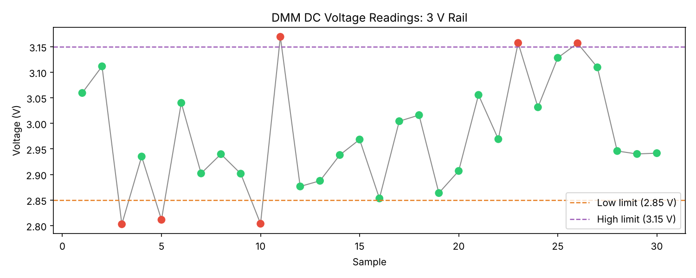

# DMM Simulation & Automated Voltage Logger

Simulates a GPIB digital multimeter (DMM) using PyVISA and pyvisa-sim, then logs and plots DC voltage readings from a virtual 3 V rail.



## What it does

- Loads a YAML instrument definition (`dmm.yaml`) that responds to standard SCPI commands
- Sends `*IDN?` to identify the instrument
- Queries `MEAS:VOLT:DC?` 30 times, 0.1 s apart, over a simulated GPIB connection
- Flags readings outside ±5% of 3 V (2.85 to 3.15 V) as OUT OF RANGE
- Computes summary statistics (min, max, mean, std dev)
- Writes results to `readings.csv`
- Plots pass/fail readings to `voltage_plot.png`

## Why PyVISA

PyVISA is the standard Python library for controlling bench instruments (oscilloscopes, DMMs, power supplies) over GPIB, USB, and Ethernet. The same script would run against a real meter by changing `RESOURCE` to its address and removing `@sim` from the resource manager.

## The simulated instrument

`dmm.yaml` defines one device at `GPIB::1::INSTR`:

| Command         | Response                                  |
| --------------- | ----------------------------------------- |
| `*IDN?`         | `SIM,DMM-3000,SN001,FW1.0`                |
| `MEAS:VOLT:DC?` | random value from 2.80 to 3.20 V          |

The random range is wider than the limits on purpose, so a typical run has a few out-of-range readings to flag.

## Setup

```
pip install -r requirements.txt
```

## Usage

```
python3 dmm_logger.py
```

Test settings are constants at the top of `dmm_logger.py`: `NOMINAL_V`, `TOLERANCE`, `NUM_SAMPLES`, and `SAMPLE_INTERVAL_S`.

## Example output

```
Connected to: SIM,DMM-3000,SN001,FW1.0
Taking 30 voltage readings...
 [01] 3.0595 V OK
 [02] 3.1116 V OK
 [03] 2.8028 V OUT OF RANGE
 ...
 [30] 2.9418 V OK

--- Summary ---
  Limits:        2.85 to 3.15 V (3.0 V ±5%)
  Samples:       30
  Min:           2.8028 V
  Max:           3.1693 V
  Mean:          2.9743 V
  Std dev:       0.1066 V
  Out of range:  6/30
Saved readings.csv
Saved voltage_plot.png
```

## Stack

Python, PyVISA, pyvisa-sim, NumPy, Matplotlib
